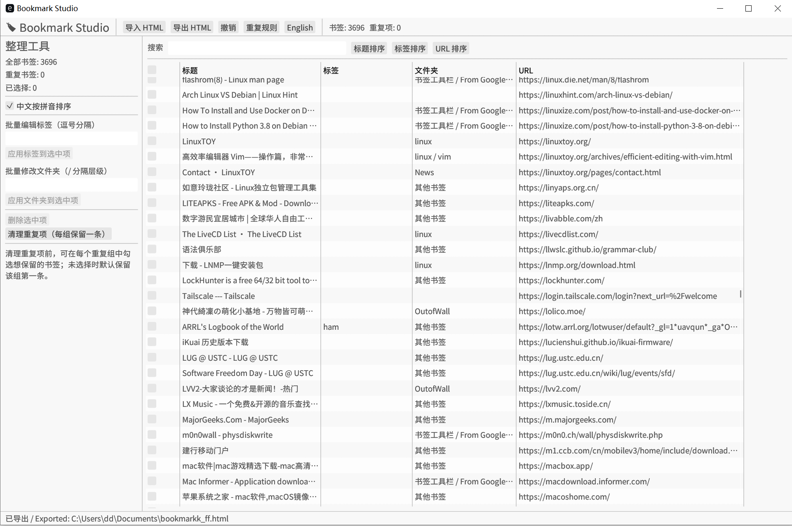
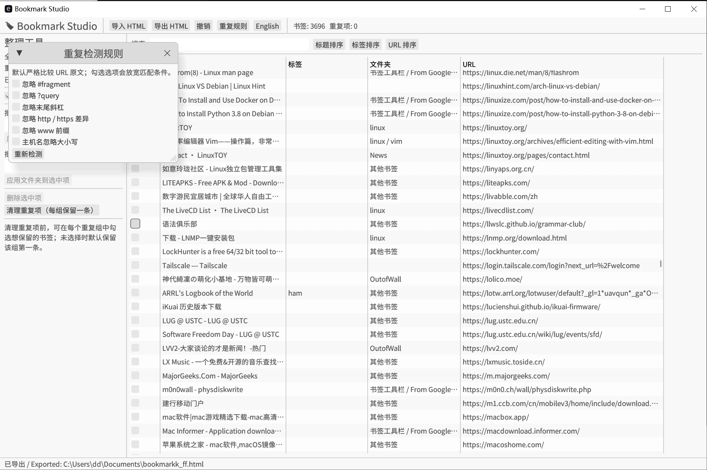

[English](#bookmark-studio)

# 跨平台浏览器书签整理工具

跨平台、离线运行的浏览器书签整理桌面应用，使用 Rust + egui 开发。

## 软件界面




## 功能

- 导入 Firefox、Chrome、Edge 导出的 Netscape Bookmark HTML（`.html` / `.htm`）。
- 解析书签标题、URL、文件夹层级、`ADD_DATE`、`LAST_MODIFIED`、`ICON`、`TAGS`。
- 搜索标题、URL、标签和文件夹路径。
- 按标题、标签、URL 排序；标题和标签支持中文拼音排序。
- 高亮完全重复的 URL。
- 自定义重复匹配：忽略 fragment、query、末尾斜杠、协议、www 前缀、主机名大小写。
- 批量删除选中书签。
- 清理重复项，每个重复组保留一条；若该组有选中项则优先保留选中项。
- 撤销最近一次删除或批量标签编辑。
- 批量替换选中书签的标签。
- 导出浏览器兼容的 Netscape Bookmark HTML，并保留文件夹层级及常见元数据。
- 简体中文 / English 界面切换。
- 所有处理在本机完成，不上传书签。

## 环境要求
- 已经在统信Linux中编译通过，见 release 中的 arm64-uoslinux 版本
- Rust stable（建议通过 https://rustup.rs/ 安装）。
- Linux 桌面环境需要 eframe/winit 对应的系统开发库。Ubuntu/Debian 可先安装：

```bash
sudo apt update
sudo apt install build-essential pkg-config libx11-dev libxrandr-dev \
  libxi-dev libxcursor-dev libxinerama-dev libxkbcommon-dev \
  libwayland-dev libxcb1-dev libgl1-mesa-dev
```

## 运行与测试

```Bash
cargo run
cargo test
```

## Release 编译

```Bash
cargo build --release
```

输出位于 `target/release/`，Windows 下为 `bookmark-studio.exe`。

## 跨平台编译

建议在对应操作系统的原生 runner 上编译，避免 Apple SDK、Windows linker 和 Linux 系统库差异。源码不需要修改。

```Bash
# Windows x64（在 Windows 上运行）
rustup target add x86_64-pc-windows-msvc
cargo build --release --target x86_64-pc-windows-msvc

# macOS Apple Silicon（在 macOS 上运行）
rustup target add aarch64-apple-darwin
cargo build --release --target aarch64-apple-darwin

# macOS Intel（在 macOS 上运行）
rustup target add x86_64-apple-darwin
cargo build --release --target x86_64-apple-darwin

# Linux x64（在 Linux 上运行）
rustup target add x86_64-unknown-linux-gnu
cargo build --release --target x86_64-unknown-linux-gnu

# Linux ARM64（在配置好 ARM64 linker/sysroot 的 Linux 环境中运行）
rustup target add aarch64-unknown-linux-gnu
cargo build --release --target aarch64-unknown-linux-gnu
```

跨操作系统交叉编译还需要目标平台 linker / SDK；优先使用 GitHub Actions 对应平台 runner。

## GitHub Actions

`.github/workflows/build.yml` 提供 Windows、macOS、Linux 构建矩阵，可在 GitHub Actions 中手动触发或推送 `v*` 标签触发。

## 重复检测说明

- 默认按 URL 原文严格比较，不会自动去掉参数、片段、协议差异或末尾斜杠。
- 勾选自定义规则后才会按规则规范化 URL。
- 删除重复项时，每组保留一条。若某组内勾选了书签，则优先保留该条；否则保留解析顺序中的第一条。
- 当前撤销栈保存最近一次可撤销操作。

## 已知边界

- Netscape Bookmark HTML 不同浏览器及版本存在细微差异；本项目针对标准导出格式解析。建议使用自己浏览器的导出文件做验收。
- 某些浏览器专有元数据可能不在 Netscape HTML 中，因此无法保证往返导出后保留所有厂商私有信息。
- 多义汉字拼音排序采用拼音库默认读音，并非上下文词典级分词排序。

## License

MIT

### 中文字体支持

该应用程序打包了 Noto Sans CJK SC，并在启动时向 egui 注册。因此，中文 UI 标签和中文书签标题不依赖于宿主操作系统上安装的字体。该字体的 SIL Open Font License 位于 `assets/OFL.txt` 中。

## 友情提醒

`Firefox` 和 `Chrome` 浏览器在处理“移动设备书签”的 HTML 导出时，表现**完全不同**：

### 1. Google Chrome：**会包含**

- **前提条件**：你的手机端 Chrome 已经登录了 Google 账号并开启了**书签同步**。
- **表现**：当手机书签同步到电脑端后，在电脑端 Chrome 的“书签管理器”中会出现一个名为 **“移动设备书签” (Mobile bookmarks)** 的文件夹。当你点击“导出书签”时，Chrome 会把整个个人资料库中的所有内容（书签栏、其他书签、移动设备书签）打包成一个 HTML 文件。因此，导出的 HTML 中是**包含**移动设备书签的。

### 2. Mozilla Firefox：**默认不包含**

- **表现**：这是 Firefox 的一个已知特性（或限制）。Firefox 的“导出书签到 HTML”功能**默认只会导出“书签菜单”和“书签工具栏”\**里面的内容，而独立存在的“移动设备书签”文件夹是\**不会**被包含在导出的 HTML 文件中的。
- **如何解决（Firefox 导出移动端书签的方法）**：
  1. **手动移动/复制**：打开 Firefox 的“管理书签”（Library）窗口，找到“移动设备书签”目录，把里面的文件夹或书签**复制或移动**到“书签菜单”或“书签工具栏”中，然后再执行导出 HTML 操作。
  2. **使用 JSON 备份**：如果不通过 HTML 导出，而是使用 Firefox 自带的“备份”（会生成 `.json` 或 `.jsonlz4` 文件），该备份会完整保存包括移动设备书签在内的所有数据。

# Bookmark Studio

A cross-platform, offline browser bookmark manager desktop application developed with Rust + egui.

## UI Preview

## Features

- Import Netscape Bookmark HTML (`.html` / `.htm`) exported from Firefox, Chrome, and Edge.
- Parse bookmark titles, URLs, folder hierarchies, `ADD_DATE`, `LAST_MODIFIED`, `ICON`, and `TAGS`.
- Search titles, URLs, tags, and folder paths.
- Sort by title, tags, or URL; titles and tags support Chinese Pinyin sorting.
- Highlight exact duplicate URLs.
- Custom duplicate matching: ignore fragment, query, trailing slash, scheme, www prefix, and hostname case.
- Batch delete selected bookmarks.
- Clean up duplicates, keeping one per group; prioritize keeping selected items if any within the group.
- Undo the last deletion or batch tag edit.
- Batch replace tags for selected bookmarks.
- Export browser-compatible Netscape Bookmark HTML, preserving folder hierarchies and common metadata.
- Switch between Simplified Chinese and English interfaces.
- All processing is done locally, with no bookmarks uploaded.

## Requirements

- Rust stable (recommended to install via https://rustup.rs/).
- Linux desktop environments require system development libraries corresponding to eframe/winit. Ubuntu/Debian users can install first:

```bash
sudo apt update
sudo apt install build-essential pkg-config libx11-dev libxrandr-dev \
  libxi-dev libxcursor-dev libxinerama-dev libxkbcommon-dev \
  libwayland-dev libxcb1-dev libgl1-mesa-dev
```

## Run & Test

```bash
cargo run
cargo test
```

## Release Build

```bash
cargo build --release
```
Output is located in `target/release/`, or `bookmark-studio.exe` on Windows.

## Cross-Platform Compilation

It is recommended to compile on the native runner of the corresponding operating system to avoid differences in Apple SDKs, Windows linkers, and Linux system libraries. No source code modifications are required.

```bash
# Windows x64 (Run on Windows)
rustup target add x86_64-pc-windows-msvc
cargo build --release --target x86_64-pc-windows-msvc

# macOS Apple Silicon (Run on macOS)
rustup target add aarch64-apple-darwin
cargo build --release --target aarch64-apple-darwin

# macOS Intel (Run on macOS)
rustup target add x86_64-apple-darwin
cargo build --release --target x86_64-apple-darwin

# Linux x64 (Run on Linux)
rustup target add x86_64-unknown-linux-gnu
cargo build --release --target x86_64-unknown-linux-gnu

# Linux ARM64 (Run in a Linux environment configured with ARM64 linker/sysroot)
rustup target add aarch64-unknown-linux-gnu
cargo build --release --target aarch64-unknown-linux-gnu
```
Cross-operating system compilation also requires target platform linkers/SDKs; it is preferred to use GitHub Actions platform-specific runners.

## GitHub Actions

`.github/workflows/build.yml` provides a Windows, macOS, and Linux build matrix, which can be triggered manually in GitHub Actions or by pushing a `v*` tag.

## Duplicate Detection Notes

- By default, URLs are compared strictly as raw strings without automatically removing parameters, fragments, protocol differences, or trailing slashes.
- URLs are normalized according to rules only when custom rules are checked.
- When deleting duplicates, one is kept per group. If any bookmark in a group is selected, that one is prioritized; otherwise, the first item in the parsing order is kept.
- The current undo stack saves the last undoable operation.

## Known Limitations

- There are subtle differences in Netscape Bookmark HTML across browsers and versions; this project targets standard export formats. It is recommended to use your own browser's exported file for verification.
- Some browser-proprietary metadata may not be present in Netscape HTML, so round-trip exports cannot guarantee the retention of all vendor-private information.
- Polyphonic Chinese character Pinyin sorting uses the Pinyin library's default pronunciation rather than context-dictionary-level tokenized sorting.

## License

MIT

### Chinese font support

The application bundles Noto Sans CJK SC and registers it with egui at startup. Chinese UI labels and Chinese bookmark titles therefore do not depend on fonts installed on the host operating system. The font's SIL Open Font License is in `assets/OFL.txt`.

## Friendly Reminder

`Firefox` and `Chrome` behave **completely differently** when exporting "Mobile bookmarks" to HTML:

### 1. Google Chrome: **Included**

- **Prerequisite**: Your mobile Chrome is logged into your Google account with **Bookmark Sync** enabled.
- **Behavior**: Once mobile bookmarks are synced to the desktop, a folder named **"Mobile bookmarks"** appears in the desktop Chrome Bookmark Manager. When you click "Export bookmarks", Chrome packages everything in your profile (Bookmarks bar, Other bookmarks, Mobile bookmarks) into a single HTML file. Therefore, mobile bookmarks **are included** in the exported HTML.

### 2. Mozilla Firefox: **Not Included by Default**

- **Behavior**: This is a known behavior (or limitation) of Firefox. Firefox's "Export Bookmarks to HTML" feature **only exports the contents of the "Bookmarks Menu" and "Bookmarks Toolbar" by default**, and the standalone "Mobile Bookmarks" folder **will not** be included in the exported HTML file.
- **Workarounds (How to export mobile bookmarks from Firefox)**:
  1. **Manual Move/Copy**: Open Firefox's "Manage Bookmarks" (Library) window, locate the "Mobile Bookmarks" folder, and **copy or move** the folders or bookmarks inside it into the "Bookmarks Menu" or "Bookmarks Toolbar" before exporting to HTML.
  2. **Use JSON Backup**: Instead of exporting to HTML, use Firefox's built-in "Backup" feature (which generates a `.json` or `.jsonlz4` file). This backup completely preserves all data, including mobile bookmarks.

[返回中文](https://www.google.com/search?q=%23跨平台浏览器书签整理工具)

